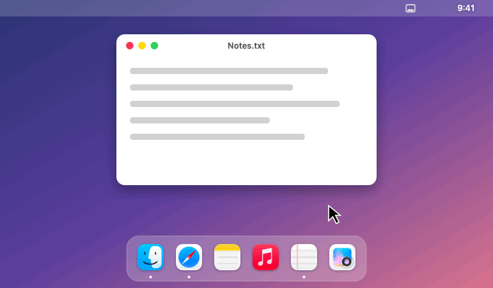
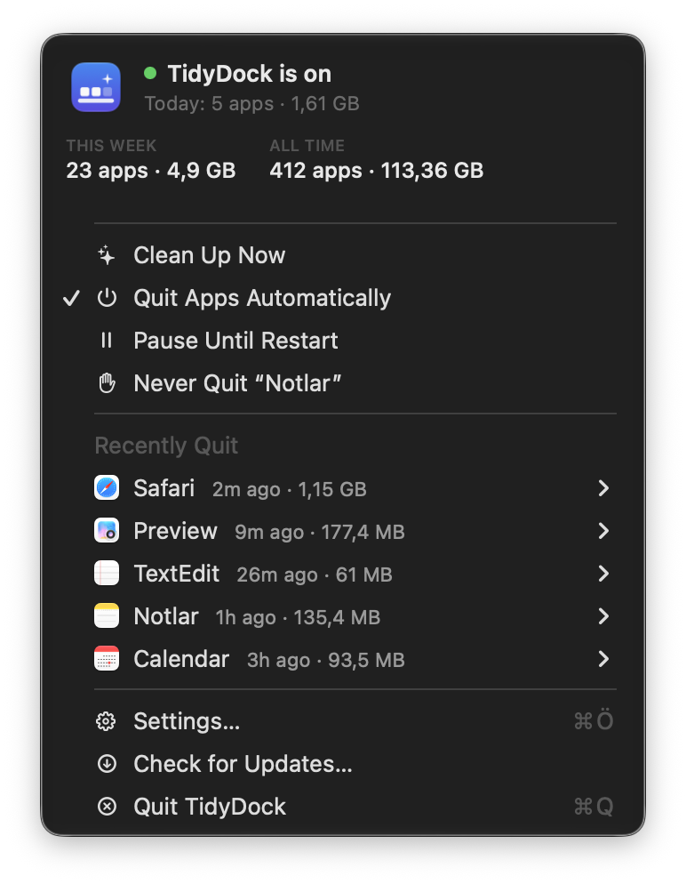
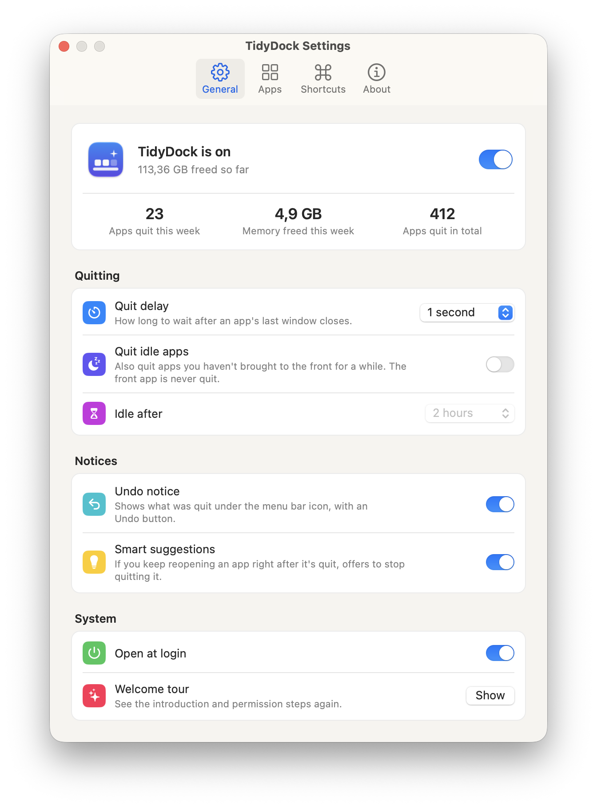

<p align="center">
  
</p>

<h1 align="center">TidyDock</h1>

<p align="center">
  Quits Mac apps once you close their last window, so your Dock only shows what you're actually using.<br>
  Free, open source, and lives in the menu bar.
</p>

<p align="center">
  <a href="https://github.com/utkumeydan/TidyDock/releases/latest"><b>Download</b></a> ·
  <a href="https://utkumeydan.github.io/TidyDock/">Website</a> ·
  <a href="README.tr.md">Türkçe</a>
</p>

<p align="center">
  
</p>

---

On macOS, closing an app's last window usually leaves the app running in the background. TidyDock watches for that and quits the app for you, exactly as if you pressed ⌘Q. Apps with unsaved changes still ask you to save.

## Features

- **Quits apps when their last window closes**, after a delay you choose (0–10 seconds).
- **Undo in one click:** a small notice under the menu bar icon shows what was quit and how much memory it freed.
- **Clean Up Now:** one click or a shortcut quits every app that's running without a window.
- **Memory stats:** see how many apps were quit and how much memory was freed today, this week and in total.
- **Smart suggestions:** reopen an app right after it's quit, and TidyDock offers to stop quitting it.
- **Optionally quits apps you haven't used for a while** (15 minutes to 24 hours). The app in front is never touched.
- **Your choice of apps:** every app except an exclusion list, or only the apps you pick. Music, Spotify, Mail and Messages are excluded by default.
- **Global shortcuts** for Clean Up Now, pause, and "never quit" for the front app.
- **Automatic updates** with Sparkle.
- **8 languages:** English, Turkish, German, Spanish, French, Italian, Japanese and Simplified Chinese.

<p align="center">
  <picture>
    <source media="(prefers-color-scheme: dark)" srcset="docs/screenshots/en/dark/menu.png">
    
  </picture>
  &nbsp;
  <picture>
    <source media="(prefers-color-scheme: dark)" srcset="docs/screenshots/en/dark/general.png">
    
  </picture>
</p>

### Designed to avoid surprise quits

- Apps that start **without a window** (login items, helpers, web app shims) are never quit by the window rule. An app is only quit after you've seen it with a window and then closed it.
- **Menu bar and background apps are never touched**, only apps with a Dock icon.
- Windows that are **minimized, hidden (⌘H), on another desktop or in full screen** count as open.
- Invisible helper windows (Discord, Firefox and other apps keep these) **don't** count as open, so those apps quit properly.
- Closing a tab or switching documents doesn't trigger a quit: the window count is checked again after the delay.
- If an app doesn't answer, TidyDock leaves it alone. It never force-quits.
- Apps are matched by **bundle ID**, so names in any language work.

## Install

**Requirements:** macOS 13 Ventura or later.

### Download

1. Download `TidyDock-x.y.z.zip` from [Releases](https://github.com/utkumeydan/TidyDock/releases) and move `TidyDock.app` to `/Applications`.
2. Open it. TidyDock is not notarized by Apple yet, so macOS blocks the first launch. Go to **System Settings › Privacy & Security** and click **Open Anyway**.
   Or remove the quarantine flag in Terminal:
   ```bash
   xattr -dr com.apple.quarantine /Applications/TidyDock.app
   ```
3. Grant **Accessibility** access when asked (System Settings › Privacy & Security › Accessibility). TidyDock uses it only to count each app's windows. It doesn't read window contents and doesn't use the network except to check for updates.

### Build from source

You only need the Xcode Command Line Tools (`xcode-select --install`).

```bash
git clone https://github.com/utkumeydan/TidyDock.git
cd TidyDock
./scripts/test.sh          # run the tests
./scripts/build-app.sh     # writes build/TidyDock.app
open build/TidyDock.app
```

## FAQ

**TidyDock stopped working after an update.**
macOS ties the Accessibility permission to the app's signature. Open System Settings › Privacy & Security › Accessibility, remove TidyDock with the − button, then add it again.

**An app was quit that shouldn't have been.**
Open the menu bar icon › Recently Quit › the app › Never Quit This App. Please also [open an issue](https://github.com/utkumeydan/TidyDock/issues/new?template=bug_report.yml) with the app's name so the default rules can improve.

**An app isn't quit when I close its last window.**
Some apps keep a real window open off screen or on another desktop. Please [open an issue](https://github.com/utkumeydan/TidyDock/issues/new?template=bug_report.yml) with the app's name and version.

**Does it work with Stage Manager, multiple desktops and full-screen apps?**
Yes. Windows on other desktops and in full screen are found through the window server.

## How it works

TidyDock keeps a record of every app with a Dock icon. It listens to Accessibility notifications (window created, destroyed, minimized) and also checks every few seconds as a fallback. To count windows it combines two sources:

1. The Accessibility API, which lists standard windows and dialogs on the current desktop, including minimized ones.
2. The window server (`CGWindowListCopyWindowInfo`), which sees every desktop. A window counts only if it belongs to a desktop, which filters out invisible helper windows.

The decision logic lives in `Sources/TidyDockCore` and has no AppKit dependency, so it's covered by unit tests.

## Contributing

Bug reports, app compatibility reports and pull requests are welcome. See [CONTRIBUTING.md](CONTRIBUTING.md).

## License

[MIT](LICENSE)
