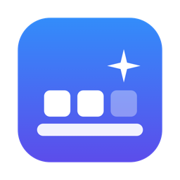
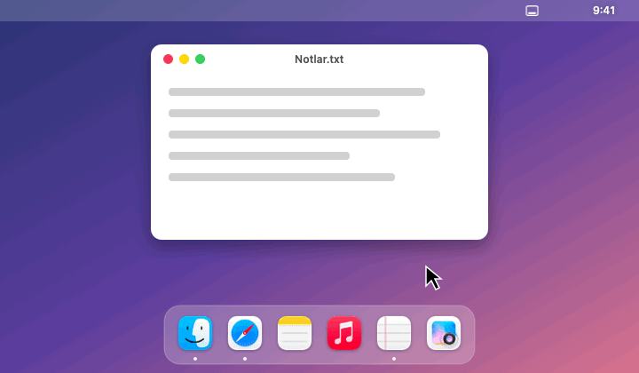
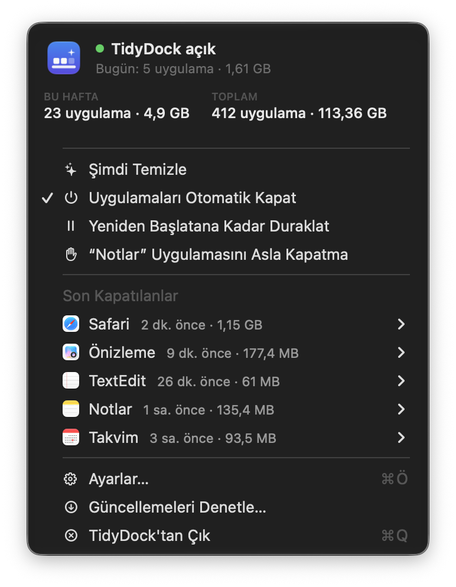
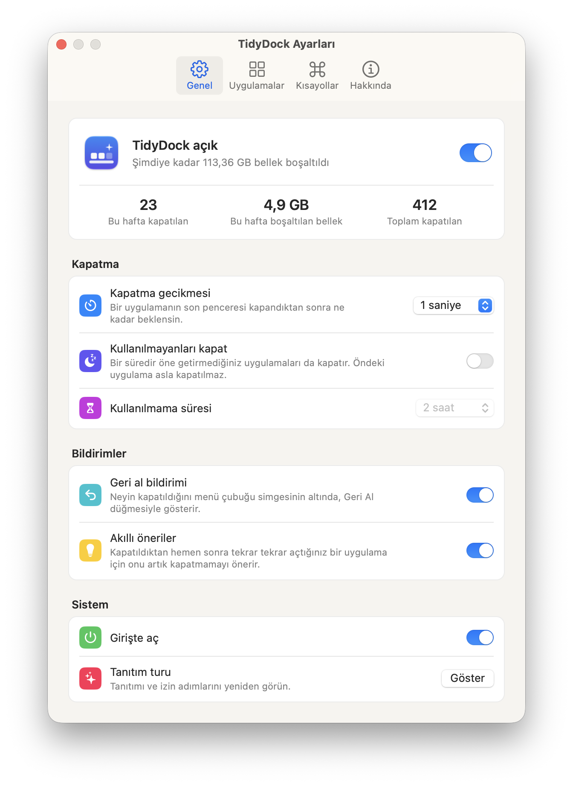

<p align="center">
  
</p>

<h1 align="center">TidyDock</h1>

<p align="center">
  Son penceresini kapattığınız Mac uygulamalarını kapatır; Dock'ta yalnızca gerçekten kullandıklarınız kalır.<br>
  Ücretsiz, açık kaynak ve menü çubuğunda çalışır.
</p>

<p align="center">
  <a href="https://github.com/utkumeydan/TidyDock/releases/latest"><b>İndir</b></a> ·
  <a href="https://utkumeydan.github.io/TidyDock/">Web sitesi</a> ·
  <a href="README.md">English</a>
</p>

<p align="center">
  
</p>

---

macOS'ta bir uygulamanın son penceresini kapatmak çoğu zaman uygulamayı arka planda çalışır hâlde bırakır. TidyDock bunu fark eder ve uygulamayı tam olarak ⌘Q'ya basmışsınız gibi kapatır. Kaydedilmemiş değişikliği olan uygulamalar yine kaydetmek isteyip istemediğinizi sorar.

## Özellikler

- **Son penceresi kapanan uygulamayı kapatır.** Gecikmeyi siz seçersiniz (0–10 saniye).
- **Tek tıkla geri alma:** Menü çubuğu simgesinin altında beliren küçük bir bildirim neyin kapatıldığını ve ne kadar bellek boşaltıldığını gösterir.
- **Şimdi Temizle:** Tek tıkla ya da bir kısayolla penceresiz çalışan tüm uygulamaları kapatır.
- **Bellek istatistikleri:** Bugün, bu hafta ve toplamda kaç uygulamanın kapatıldığını ve ne kadar bellek boşaltıldığını gösterir.
- **Akıllı öneriler:** Kapatılan bir uygulamayı hemen yeniden açarsanız TidyDock onu artık kapatmamayı önerir.
- **İsteğe bağlı olarak bir süredir kullanmadığınız uygulamaları da kapatır** (15 dakika ile 24 saat arası). Öndeki uygulamaya dokunmaz.
- **Hangi uygulamaların kapanacağını siz seçersiniz:** bir hariç tutma listesi dışındaki tüm uygulamalar ya da yalnızca seçtikleriniz. Müzik, Spotify, Mail ve Mesajlar varsayılan olarak hariç tutulur.
- **Genel kısayollar:** Şimdi Temizle, duraklatma ve öndeki uygulamayı "asla kapatma" listesine ekleme.
- **Sparkle ile otomatik güncelleme.**
- **8 dil:** Türkçe, İngilizce, Almanca, İspanyolca, Fransızca, İtalyanca, Japonca ve Basitleştirilmiş Çince.

<p align="center">
  <picture>
    <source media="(prefers-color-scheme: dark)" srcset="docs/screenshots/tr/dark/menu.png">
    
  </picture>
  &nbsp;
  <picture>
    <source media="(prefers-color-scheme: dark)" srcset="docs/screenshots/tr/dark/general.png">
    
  </picture>
</p>

### Yanlışlıkla kapatmayı önleyen kurallar

- **Penceresiz başlayan** uygulamalar (giriş öğeleri, yardımcı uygulamalar, web uygulaması kısayolları) pencere kuralıyla asla kapatılmaz. Bir uygulama ancak pencereli görüldükten sonra son penceresi kapanırsa kapatılır.
- **Menü çubuğu ve arka plan uygulamalarına dokunulmaz.** Yalnızca Dock'ta simgesi olan uygulamalar kapatılır.
- **Simge durumuna küçültülmüş, gizlenmiş (⌘H), başka masaüstünde ya da tam ekranda** olan pencereler açık sayılır.
- Görünmez yardımcı pencereler (Discord, Firefox ve benzerlerinde olur) açık **sayılmaz**, böylece bu uygulamalar da düzgün kapanır.
- Bir sekmeyi kapatmak ya da belgeler arasında geçmek kapatmayı tetiklemez. Pencere sayısı gecikmeden sonra yeniden kontrol edilir.
- Yanıt vermeyen bir uygulamaya dokunulmaz. TidyDock asla zorla kapatmaz.
- Uygulamalar **bundle ID** ile tanınır, bu yüzden her dildeki uygulama adı sorunsuz çalışır.

## Kurulum

**Gereksinim:** macOS 13 Ventura veya üzeri.

### İndirme

1. [Releases](https://github.com/utkumeydan/TidyDock/releases) sayfasından `TidyDock-x.y.z.zip` dosyasını indirip `TidyDock.app`'i `/Applications` klasörüne taşıyın.
2. Uygulamayı açın. TidyDock henüz Apple tarafından onaylanmadığı (notarize edilmediği) için macOS ilk açılışı engeller. **Sistem Ayarları › Gizlilik ve Güvenlik** bölümüne gidip **Yine de Aç** düğmesine tıklayın.
   Ya da karantina işaretini Terminal'den kaldırın:
   ```bash
   xattr -dr com.apple.quarantine /Applications/TidyDock.app
   ```
3. İstendiğinde **Erişilebilirlik** izni verin (Sistem Ayarları › Gizlilik ve Güvenlik › Erişilebilirlik). TidyDock bu izni yalnızca uygulamaların pencerelerini saymak için kullanır. Pencere içeriklerini okumaz; güncelleme denetimi dışında ağa bağlanmaz.

### Kaynak koddan derleme

Yalnızca Xcode Command Line Tools gerekir (`xcode-select --install`).

```bash
git clone https://github.com/utkumeydan/TidyDock.git
cd TidyDock
./scripts/test.sh          # testleri çalıştırır
./scripts/build-app.sh     # build/TidyDock.app oluşturur
open build/TidyDock.app
```

## Sık sorulan sorular

**Güncellemeden sonra TidyDock çalışmayı bıraktı.**
macOS, Erişilebilirlik iznini uygulamanın imzasına bağlar. Sistem Ayarları › Gizlilik ve Güvenlik › Erişilebilirlik bölümünde TidyDock'u − düğmesiyle kaldırıp yeniden ekleyin.

**Kapanmaması gereken bir uygulama kapandı.**
Menü çubuğu simgesi › Son Kapatılanlar › uygulama › Bu Uygulamayı Asla Kapatma yolunu izleyin. Varsayılan kuralların iyileşmesi için uygulamanın adıyla bir [issue açın](https://github.com/utkumeydan/TidyDock/issues/new?template=bug_report.yml).

**Son penceresini kapattığım bir uygulama kapanmıyor.**
Bazı uygulamalar ekran dışında ya da başka bir masaüstünde gerçek bir pencere açık tutar. Uygulamanın adı ve sürümüyle bir [issue açın](https://github.com/utkumeydan/TidyDock/issues/new?template=bug_report.yml).

**Sahne Yöneticisi, birden çok masaüstü ve tam ekran uygulamalarla çalışıyor mu?**
Evet. Başka masaüstlerindeki ve tam ekrandaki pencereler pencere sunucusu üzerinden bulunur.

## Katkıda bulunma

Hata bildirimleri, uygulama uyumluluk raporları ve pull request'ler memnuniyetle karşılanır. Ayrıntılar [CONTRIBUTING.md](CONTRIBUTING.md) dosyasında.

## Lisans

[MIT](LICENSE)
